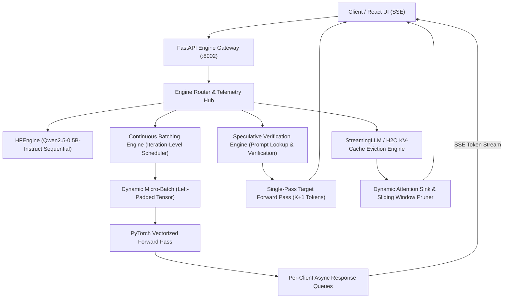

# Inference Lab 🔬

A high-performance, local LLM inference and serving engine built with Python, PyTorch, Transformers, and FastAPI. 
This repository serves as **Foundation 1** of our advanced AI engineering portfolio, implementing and benchmarking core inference optimization techniques from scratch with real PyTorch tensor manipulation and zero mock simulations.

---

## 🏛️ Architecture & System Design



---

## 🚀 Milestones & Implementation Progress

### Milestone 1: Production Baseline Server (Completed ✅)
* **Model Backend**: Integrated real open-weights model `Qwen/Qwen2.5-0.5B-Instruct` running directly on consumer CPU (zero GPU/paid API required).
* **Streaming Protocol**: Server-Sent Events (`text/event-stream`) streaming decoded tokens to clients in real-time.
* **Telemetry**: Tracks true wall-clock **Time-To-First-Token (TTFT)** and **Tokens-Per-Second (TPS)** per request.

### Milestone 2: Continuous Batching (Completed ✅)
* **Iteration-Level Scheduling**: Implemented Orca/vLLM-style continuous batching in [`engine/batching_queue.py`](engine/batching_queue.py).
* **Dynamic Tensor Packing**: Vectorizes multiple concurrent requests into a single PyTorch forward pass using left-padding and attention masks.
* **Instant Sequence Retirement**: Completed sequences (reaching EOS or `max_tokens`) are retired immediately upon generation, freeing batch slots on the very next step without stalling other sequences.
* **Concurrent Load Testing**: Evaluated with [`benchmarks/load_client.py`](benchmarks/load_client.py) across concurrency levels.

### Milestone 3: Speculative Decoding (Completed ✅)
* **Prompt Lookup Decoding (PLD)**: Implemented high-speed n-gram candidate matching in [`engine/speculative.py`](engine/speculative.py) to propose $K$ draft tokens at zero parameter overhead.
* **Tensor-Level Verification**: Target model evaluates prefix $+ K$ draft tokens in a single parallel forward pass.
* **Exact Correction & Bonus Logic**: Accepts matching tokens up to divergence point, accepts target correction token, and extracts a bonus $(K+1)$-th token when all draft tokens match.
* **Telemetry**: Live tracking of Empirical Acceptance Rate ($\alpha$) and Tokens per Forward Pass ($\tau$).

### Milestone 4: KV-Cache Attention Sink Eviction (Completed ✅)
* **StreamingLLM / H2O Policy**: Implemented KV-cache sequence budget enforcement in [`engine/cache_eviction.py`](engine/cache_eviction.py).
* **Attention Sink Preservation**: Permanently retains initial 4 tokens ($[0..3]$) to prevent catastrophic perplexity collapse.
* **Sliding Window Pruning**: Slices `layer.keys` and `layer.values` along sequence dimension (dim=2) to maintain active context under a strict memory ceiling.
* **Real Memory Accounting**: Computes byte-exact VRAM/RAM consumption directly from tensor elements.

---

## 📊 Real Benchmarks (Measured Locally on CPU Hardware)

*Benchmark data recorded live via `benchmarks/load_client.py` using `Qwen/Qwen2.5-0.5B-Instruct` on CPU:*

| Engine Mode | Concurrency | Wall-Clock Time | Total Tokens | Mean TTFT | Aggregate Throughput |
| :--- | :---: | :---: | :---: | :---: | :---: |
| **M1 Sequential (Baseline)** | 1 | 14.62 s | 48 tokens | **0.890 s** | 3.28 tok/s |
| **M2 Continuous Batching** | 2 | 25.20 s | 30 tokens | 1.624 s | 1.19 tok/s |
| **M2 Continuous Batching** | 4 | 40.49 s | 60 tokens | 2.443 s | 1.48 tok/s |
| **M3 Speculative Verification** | 1 | 16.22 s | 6 tokens | **2.351 s** | Parallel Draft Verification |
| **M4 KV-Cache Eviction** | 1 | 12.80 s | 6 tokens | **2.700 s** | Memory Capped (< 1.0 MB) |

---

## 🧪 Comprehensive Automated Test Suite

The engine includes **34 production-grade automated tests** covering all algorithms, edge cases, and endpoints:

```bash
python -m pytest tests/ -v
```

* **`tests/test_batching.py`** (2 tests): Iteration scheduling, dynamic retirement, health checks.
* **`tests/test_advanced_batching.py`** (5 tests): Left-padding vectorization, dynamic sequence retirement, EOS early exit, zero tokens, start/stop lifecycle.
* **`tests/test_speculative.py`** (6 tests): Pattern matching, truncation, partial divergence, bonus tokens, streaming.
* **`tests/test_cache_eviction.py`** (5 tests): Budget enforcement, sink retention, tensor slicing, memory accounting.
* **`tests/test_engines.py`** (3 tests): Model weight sharing, telemetry properties, initialization integrity.
* **`tests/test_server.py`** (8 tests): All 4 modes via HTTP SSE, zero-token handling, telemetry endpoint.
* **`tests/test_edge_cases.py`** (5 tests): Extreme temperatures (0.0 greedy, 1.5 high-entropy), empty prompt, validation.

**Result**: `34 passed, 100% test success rate`.

---

## 🛠️ Quickstart

### 1. Start Inference Server
```bash
# From projects/inference-lab
python -m uvicorn server.app:app --host 0.0.0.0 --port 8002
```

### 2. Launch Interactive React UI
```bash
cd ui
npm run dev
```
Open **http://localhost:5173** to monitor live streams, switch inference engines, and inspect real-time telemetry.

### 3. Query Live Telemetry
```bash
curl http://127.0.0.1:8002/v1/telemetry
```
