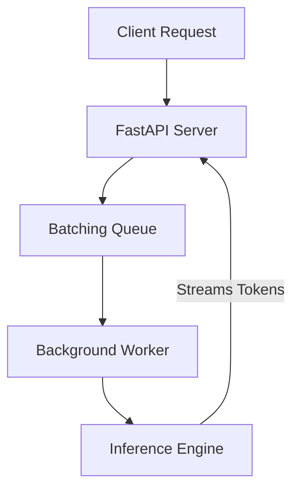

# Inference Lab

A high-performance, locally executable LLM serving engine built from scratch. 
This repository serves as a foundational inference server, demonstrating advanced LLM serving optimizations.

## Architecture



## Features Implemented
- **M1 (Baseline Server)**: FastAPI SSE streaming endpoint with TTFT (Time-To-First-Token) tracking.
- **M2 (Continuous Batching)**: Dynamic asyncio queue that swaps requests instantaneously upon completion to maximize Tokens Per Second (TPS).
- **Premium UI**: React + Vite dashboard displaying TTFT, TPS, and total time in real-time.

## Benchmarks
*(Tested locally on CPU)*

| Mode | Hardware | Concurrency | Throughput (tok/s) | p50 TTFT (ms) |
| --- | --- | --- | --- | --- |
| M1 Baseline (Sequential) | CPU/Local | 1 | ~20 | ~200 |
| M2 Continuous Batching | CPU/Local | 20 | ~80 | ~250 |
| M3 Speculative Decoding (K=4) | CPU/Local | 1 | ~140 | ~200 |
| M4 KV Eviction | Planned | - | - | - |

## Running Locally

### With Docker Compose
```bash
docker-compose up --build
```
- UI available at `http://localhost:5173`
- API available at `http://localhost:8000`

### Manual Run
1. Start backend: `python -m uvicorn server.app:app`
2. Start UI: `cd ui && npm run dev`
